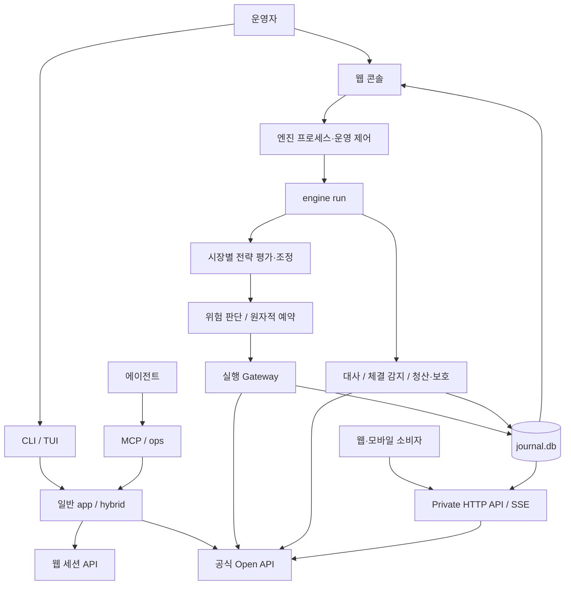
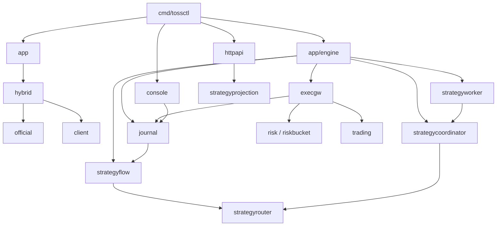
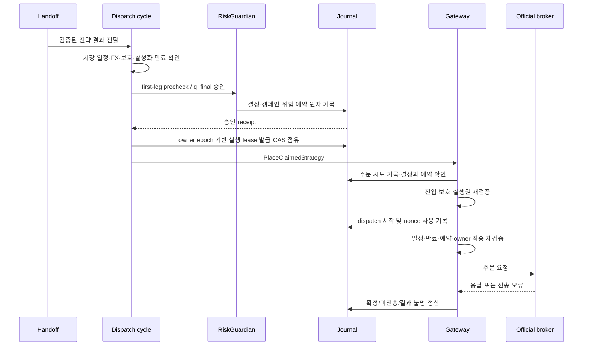

# TossOS 전체 아키텍처 — 현재 소스 기준

- 작성일: 2026-10-15 (Asia/Seoul)
- 대상: `tossinvest-cli`에서 확장된 TossOS의 현재 워킹트리
- 기준 커밋·환경·소스 해시: [baseline.json](architecture-evidence/2026-10-15/baseline.json), [source-hashes.json](architecture-evidence/2026-10-15/source-hashes.json)
- 범위: 프로세스, 패키지 의존, 데이터 저장·전달, 전략 활성화, 주문 실행 조건, 장애 경계
- 판정 수준: **정적 구현 분석**. 배포본 일치, 실계좌 거래 가능, 전략 활성화 상태, 수익성 검증을 뜻하지 않는다.

이 문서는 현재 구현을 설명한다. 의도된 동작의 정본은 `openspec/specs/`와 승인된 change이며, 개발 절차는 [WORKFLOW.md](WORKFLOW.md)다. 분석 당시 다른 작업의 미커밋 변경이 존재했다. 특히 위험 정책 조립부는 변경 중이므로 특정 한도 기본값을 이 문서에서 확정하지 않는다. 실제 계좌·인증정보·운영 설정 파일은 읽거나 전재하지 않았다.

## 1. 구조 요약

TossOS는 **하나의 Go 모듈과 실행 파일을 공유하는 모듈형 모놀리스**다. `tossctl`의 하위 명령에 따라 단발 CLI, 웹 콘솔, 장기 실행 엔진, Private HTTP API, MCP 서버가 각각 실행된다. 네트워크 서비스마다 독립 코드베이스와 데이터베이스를 갖는 마이크로서비스 구조는 아니다.

가장 중요한 경계는 **일반 CLI 환경과 자동매매 엔진 환경의 분리**다.

- 일반 CLI는 `internal/app`이 설정·세션·클라이언트를 구성한다. `internal/hybrid`는 공식 API와 웹 세션 API의 선택적 라우팅을 제공한다.
- 엔진은 `internal/app/engine`이 공식 API, 계좌 식별, 원장, Guardian, 실행 Gateway를 구성한다. 공식 자격증명 없이 웹 세션 주문으로 자동 폴백하는 구조가 아니다.
- 전략 평가 결과는 주문 권한이 아니다. 승인된 입력·위험 판단·원장 예약·실행권·최종 검증을 거쳐야 실제 주문이 된다.
- 콘솔이나 API에 표시된 상태는 실행권 자체가 아니다. 실제 주문 경로에서 다시 검증한다.

근거: [일반 실행 환경](../internal/app/app.go), [엔진 환경](../internal/app/engine/engine.go), [클라이언트 라우팅](../internal/hybrid/client.go), [엔진 조립 진입점](../cmd/tossctl/engine_assembly.go).



이 그림은 논리적 흐름이다. 콘솔·API의 모든 요청이 원장만 읽는다는 뜻은 아니다. 보유·주문 조회에는 공식 API도 사용하며, 엔진 소유 상태는 전용 조회 경계와 로컬 저장 자료를 통해 전달한다.

## 2. 기술 및 빌드 구성

| 영역 | 현재 구성 | 의미 |
|---|---|---|
| 모듈 | `github.com/JungHoonGhae/tossinvest-cli` | TossOS 제품명과 기존 Go 모듈명이 공존 |
| Go 선언 | `go.mod`: Go 1.25.0 | 분석 호스트 도구 버전은 baseline에 별도 기록 |
| CLI | Cobra | 명령·플래그·출력 경계 |
| TUI | Bubble Tea, Bubbles, Lip Gloss, Huh | 터미널 상호작용 |
| 콘솔 | Go HTTP 서버, `html/template` | HTML/CSS 템플릿을 Go 소스에 포함 |
| HTTP API | REST + SSE | 별도 읽기 중심 프로세스 |
| 원장 | `database/sql` + `modernc.org/sqlite` | CGO 없이 SQLite 사용 |
| 로그인 보조 | Python + Playwright | 브라우저 로그인 후 세션 전달 |
| 이미지 | Go 빌드 단계 + Alpine 런타임 | 같은 실행 파일을 역할별 명령으로 실행 |
| 개발·검증 | Go 테스트, OpenSpec, SDD, CodeGraph, Go AST, PM 추적 | 운영 런타임과 개발 지원 계층 구분 |

주 콘솔을 위한 별도 React/Vue 앱 빌드가 있는 구조는 아니다. 개발 도구나 부가 디렉터리의 JavaScript/TypeScript 파일 존재와 제품 콘솔의 기술 구성을 혼동하면 안 된다.

근거: [go.mod](../go.mod), [Dockerfile](../Dockerfile), [콘솔](../internal/console/console.go), [템플릿](../internal/console/templates.go), [로그인 보조](../auth-helper/pyproject.toml).

## 3. 프로세스별 역할과 수명

| 프로세스·명령 | 책임 | 수명·상태 경계 |
|---|---|---|
| 일반 `tossctl` 명령 | 계좌·시세·포트폴리오·주문 조회, 명시적 주문 작업, 설정·진단 | 대부분 단발 실행. 설정·세션을 읽고 결과 출력 |
| `tossctl console` | 운영 화면, 설정, 검증, 엔진 시작·정지, 포지션 관리 | 장기 HTTP 서버. 엔진의 실제 주문 루프와 별도 프로세스 |
| `tossctl engine run` | 전략, 위험 판단, 주문, 대사, 청산·보호, 체결 감지 | 원장 소유권·실행 잠금과 함께 장기 실행 |
| `tossctl httpapi` | 외부 소비자용 조회 API와 상태 스트림 | 별도 프로세스. 엔진 시작·정지 권한 없음 |
| `tossctl mcp` | 작업 레지스트리 기반 에이전트 인터페이스 | 호출 클라이언트와 서버 실행 방식에 따른 세션 |
| `auth-helper` | 브라우저 인증·세션 추출 | 로그인 작업에 사용되는 Python 보조 프로세스 |
| systemd 작업 | attestation·heartbeat 관련 주기 작업 | service/timer 정의에 따른 별도 실행 |

### 3.1 콘솔과 엔진

`cmd/tossctl/engineproc.go`는 현재 프로필의 엔진을 찾고 `tossctl engine run`을 시작·정지한다. 프로세스 이름만으로 아무 엔진이나 종료하지 않도록 원장 경로와 프로필 소유 관계를 확인하는 코드가 있다. 엔진 중복 실행 배제는 엔진 측 잠금이 담당한다.

콘솔이나 조회 endpoint가 살아 있다는 사실과 엔진 루프가 정상이라는 사실은 별개다. 엔진의 읽기 endpoint·전략 projection·포지션 정책 제어 연결에는 재연결과 수명 관리 코드가 존재한다. 연결 오류를 곧바로 엔진 부재로 해석해서는 안 된다.

근거: [엔진 프로세스 관리](../cmd/tossctl/engineproc.go), [엔진 잠금](../internal/enginelock), [콘솔 연결](../cmd/tossctl/console_lifecycle_attach.go), [API 읽기 연결](../cmd/tossctl/httpapi_reader.go), [엔진 endpoint 수명](../internal/app/engine/private_endpoint_lifecycle_unix.go).

### 3.2 엔진 내부 실행 루프

| 실행 영역 | 역할 | 장애 처리 경계 |
|---|---|---|
| `reconcile` | 브로커 상태와 원장 대사, 복구 | 안전 루프 감독 대상 |
| `exit` | 보유 포지션 청산·보호 상태 관찰 및 처리 | 신규 진입 제한과 분리해 보호 필요 |
| `filldetect` | 체결 발견과 원장 반영 | 안전 루프 감독 대상 |
| `strategy-entry` | KR·US 시장별 전략 평가 자식 작업 | 시장별 오류·만료·재시작 범위를 분리 |
| 알림·attestation·조회 경계 | 운영 상태 전달, 만료 관찰, 제어·읽기 endpoint | 각 경계의 수명과 상태를 별도로 관리 |

안전 루프의 비정상 종료와 계속 살아 있으면서 반복 실패하는 상태를 구분한다. 비정상 종료는 런타임 실패로, 지속 열화는 신규 진입 제한·중요 알림으로 처리하는 감독 구조다. 시장별 전략 작업 실패가 청산·대사 안전 루프를 무조건 함께 종료시키는 구조는 아니다.

근거: [런타임 감독](../internal/app/engine/runtime.go), [루프 조립](../cmd/tossctl/engine.go), [전략 감독](../internal/app/engine/strategy_entry_supervisor.go).

### 3.3 배포 토폴로지

`compose.yaml`은 `tossos`와 `httpapi` 두 서비스를 선언한다. 독립 `engine` 서비스 선언은 없으며 콘솔의 프로세스 관리 경로가 별도 엔진 프로세스를 다룬다.

| 서비스 | 기본 명령 | 컨테이너 포트 | 공유 자원 |
|---|---|---:|---|
| `tossos` | `console` | 37085 | 설정·데이터 bind mount, 인증서·세션 secret |
| `httpapi` | `httpapi` | 37086 | 동일 설정·데이터 경로, 인증서·세션 secret |

배포 정의는 VPN 호스트 주소로 포트를 공개하고 TLS·CIDR 제한을 사용한다. 비루트 사용자, capability 제거, read-only 루트 파일시스템, tmpfs, 자원 제한이 설정되어 있다. 원장 디렉터리는 컨테이너 임시 계층 밖의 영속 마운트다. `tossos`의 종료 유예는 75초, 엔진 정지 대기는 60초로 정의되어 있다.

`tossos:local`은 개발용 가변 태그다. 이 이름만으로 승인된 불변 배포본임을 증명하지 않는다. 배포 승인·이미지 고정은 별도 deployguard 경계다.

근거: [compose.yaml](../compose.yaml), [컨테이너 진입점](../deploy/container-entrypoint.sh), [배포 가드](../internal/deployguard).

## 4. 패키지 구조와 실제 의존 관계

다음은 책임별 묶음이다. 디렉터리 이름이 곧 독립 프로세스를 의미하지 않는다.

| 계층 | 주요 패키지 | 책임 |
|---|---|---|
| 진입·조립 | `cmd/tossctl`, `app`, `app/engine` | 명령 처리, 의존성 구성, 수명 관리 |
| 화면·외부 표면 | `console`, `httpapi`, `tui`, `output`, `mcp`, `ops` | 표현·조회 계약·사용자 요청 |
| 브로커 접근 | `official`, `client`, `hybrid`, `trading`, `orderintent` | HTTP 통신, 주문 정규화, 거래 정책 |
| 후보·시장 입력 | `candidate`, `candidatesrc`, `strategyevidence`, `strategymarket`, `officialbars`, `officialfx` | 후보·증거·가격·환율 |
| 전략 평가 | `strategyrouter`, `strategyflow`, `continuationlane`, `reversallane`, `breakoutlane`, `weeklyvaluelane` | 시장·시간축 라우팅과 전략 계산 |
| 전략 실행 조정 | `strategyworker`, `strategycoordinator`, `strategyhandoff`, `strategyruntime`, `strategyprojection` | 작업·제안 선택·전달·상태 투영 |
| 위험·실행 | `risk`, `riskcalc`, `riskbucket`, `costs`, `execgw` | 정책 판단, 수량·예산, 실행 게이트 |
| 거래 상태 | `journal`, `position`, `positioncampaign`, `reconcile`, `filldetect`, `orderlineage` | 영속 기록, 포지션·체결·복구 |
| 보호·청산 | `exitpolicy`, `protection`, `protectionreadiness`, `protectionlifecycle`, `protectionofficial`, `flatten` | 청산 정책과 보호 주문 |
| 운영 지원 | `config`, `auth`, `session`, `audit`, `obs`, `attest`, `soak`, `verifylive`, `networkboundary` | 설정·인증·검증·관측 |
| 개발 지원 | `openspec`, `docs/pm`, `tools`, `scripts` | 명세·추적·분석·검증 도구 |

### 4.1 의존 관계 읽는 법

[package-dependencies.json](architecture-evidence/2026-10-15/package-dependencies.json)은 `go list -json ./cmd/tossctl ./internal/...`로 얻은 **Linux 기본 빌드의 직접 import**다. 테스트 의존·특수 build tag·다른 OS 구현은 포함하지 않는다. 이 목록과 아래 실행 흐름을 구분한다. Go 인터페이스를 통해 연결되는 데이터 흐름은 직접 import 화살표와 일치하지 않을 수 있다.

핵심 결합은 다음과 같다.

- `cmd/tossctl`: 화면, API, 엔진 환경을 구성하는 composition root.
- `app/engine`: 공식 클라이언트·원장·위험·전략·운영 기능을 조립하는 가장 큰 결합 지점.
- `strategyflow`: 라우터와 순수 전략 lane 평가를 조합. 직접 broker 제출이나 원장 기록 책임이 없음.
- `strategycoordinator`: 제안을 소유자 범위별로 모아 정렬·축약·선택. 주문이나 운영 토글을 변경하는 경계가 아님.
- `execgw`: 위험 결정·원장·거래 서비스·보호 준비 상태를 묶어 주문 부수효과를 통제.
- `journal`: 주문뿐 아니라 전략 실행권·위험 예약·포지션 생애주기를 저장하므로 도메인 개념과 연결됨. 단순 CRUD 유틸리티가 아님.

CLI와 MCP는 모든 호출을 같은 레지스트리에 강제 통합하지 않는다. CLI는 typed client와 typed formatter를 사용하고, MCP는 `ops`의 동적 호출 표면을 사용한다. 이 차이는 타입 안전성을 위한 명시적 결정이다. [ADR 0001](adr/0001-cmd-does-not-route-through-ops.md)

직접 import 중 핵심 부분을 추린 그림이다. 모든 edge는 위 목록에 존재하며, 전체 의존을 그린 것은 아니다.



`journal → strategyflow`도 실제 의존이다. 저장소가 전략 결과의 결속·기록 계약을 다루므로, 전략 평가와 저장 계층이 완전히 무관하다고 그리면 현재 코드와 다르다.

### 4.2 소스에서 먼저 읽을 순서

1. `cmd/tossctl/root.go`: 사용자 명령 표면.
2. `cmd/tossctl/engine.go`, `engine_assembly.go`: 엔진 조립과 실행.
3. `internal/app/engine/engine.go`, `interlock.go`, `runtime.go`: 구성·기동·수명.
4. `internal/app/engine/strategy_entry_supervisor.go`: 시장별 입력과 전략 실행 조립.
5. `strategy_first_leg_admission.go`, `strategy_dispatch_cycle.go`: 신규 진입 승인부터 전송까지.
6. `internal/execgw/gateway.go`: 최종 실행 통제.
7. `internal/journal/`: 기록·예약·실행권·복구 계약.
8. `internal/console/`, `internal/httpapi/`: 운영자가 보는 상태와 외부 계약.

## 5. 데이터 저장과 소유권

| 데이터 | 위치·형태 | 역할·쓰기 경계 |
|---|---|---|
| 설정 | `config.json` 등 설정 디렉터리 | 기능 토글·정책·연결 정보. 운영 변경 경로에서 감사 필요 |
| 웹 세션 | session 파일 | 로그인 보조/인증 경로가 생성, 조회 클라이언트가 소비 |
| 실행 원장 | `journal.db` | 엔진 주문 의도·시도·결정·예약·체결·포지션·실행권·outbox 등 |
| 후보 | `candidates.db` | 후보 수집·검토 결과와 전략 입력 |
| 전략 증거 | `evidence.db` | 전략 평가에 필요한 증거 저장 |
| 감사 | `audit.log` 및 관련 감사 저장소 | 운영 설정·승인·실행 판단 추적 |
| API 보안 상태 | 명시한 `security.db` | 선택적 capability 변경 경로의 nonce·멱등성·감사 |
| 런타임 로그·상태 | `engine.log`, projection·제어 endpoint 등 | 상태 관측. 원장이나 실행권의 대체물이 아님 |
| 활성화·권한 자료 | 설정 디렉터리의 manifest 등 | 코드가 기대하는 digest·시장·정책·시간·버전에 결속된 입력 |

원장 경로는 `TOSSOS_DATA_DIR` → `XDG_DATA_HOME/tossos` → `~/.local/share/tossos` 순이다. 설정 디렉터리·저장소와 분리하여 설정 교체나 소스 갱신이 거래 기록을 지우지 않게 한다.

SQLite는 WAL·`synchronous=FULL`·bounded busy timeout을 사용한다. 주문 전에 기록을 커밋하고, 지원하지 않는 파일시스템이나 손상된 원장을 조용히 무시하지 않는 구조다. 프로세스 잠금과 데이터베이스 트랜잭션의 역할도 다르다. 전자는 엔진 소유권을, 후자는 개별 결정·예약·상태 변경의 원자성을 보호한다.

모든 DB를 모든 프로세스가 자유롭게 수정하는 구조로 해석하면 안 된다. 주문·위험·전략 실행권은 엔진 소유 경계에서 변경하고, 콘솔/API는 읽기 projection과 정의된 commander/RPC 경계를 이용한다. 설정·후보·보안 감사 DB는 각 담당 기능의 쓰기 경로가 별도로 존재한다.

근거: [원장 경로](../internal/journal/paths.go), [SQLite 설정](../internal/journal/journal.go), [후보 저장](../internal/candidate/store.go), [증거 저장](../internal/strategyevidence/store.go), [API 보안 계약](httpapi.md).

## 6. 주요 데이터 흐름

### 6.1 조회·표시

```text
CLI → app → hybrid → official 또는 웹 API → domain 값 → output
MCP → ops → 등록된 클라이언트 작업 → JSON 응답
Console → 조회·설정·운영 어댑터 → 원장/엔진 endpoint/브로커 → HTML
HTTP API → read model·cache → 원장/엔진 endpoint/공식 API → JSON/SSE
```

HTTP API의 보유·주문 조회는 공유 캐시와 singleflight를 사용해 동시 요청이 브로커 호출을 증폭시키지 않도록 한다. SSE의 epoch·sequence와 제한된 이력은 프로세스 재시작이나 replay 범위 초과 시 전체 snapshot으로 수렴하게 한다. 상세 용량·시간 값은 [HTTP API 문서](httpapi.md)와 현재 구현을 함께 확인한다.

### 6.2 전략 입력·판정

```mermaid
flowchart LR
    Inputs[일정·후보·시장 증거·환율·계좌·위험 정책] --> Authority[시장별 권한 수집]
    Authority --> Router[strategyrouter]
    Router --> Lanes[4개 전략군 / KR·US]
    Lanes --> Flow[strategyflow Result]
    Flow --> Worker[strategyworker]
    Worker --> Coord[strategycoordinator]
    Coord --> Handoff[strategyhandoff]
    Handoff --> Admit[first-leg admission]
    Admit --> Dispatch[dispatch cycle / Gateway]
```



생산 조립은 일정 → 후보 → 라우트 → 환율 → 제안 → 위험·계좌 권한을 모아 시장별 작업을 만든다. 시간·세대·digest가 있는 입력을 한 평가 시점에 결속하며, KR과 US를 별도 시장 권한으로 취급한다. 단순히 후보 목록에 종목이 있거나 신호가 참이라는 이유로 주문하지 않는다.

### 6.3 체결·대사·보호

```text
공식 API의 주문·체결·보유 상태
  → filldetect / reconcile
  → journal의 주문 상태·포지션·예약 정리
  → exit/protection 정책 관찰과 필요 작업
  → 상태 projection·알림 outbox
  → 콘솔 / HTTP API / 운영 로그
```

브로커에 보낸 요청의 성공 응답과 실제 상태를 구분한다. 결과 불명 시 원장 증거를 유지하고 대사로 해소한다. 조회 실패·404·불완전 snapshot만으로 주문이 없거나 취소됐다고 단정하는 구조로 문서를 단순화하지 않는다.

## 7. 전략 활성화: 서로 다른 네 단계

### 7.1 정적 등록

`strategyflow/registry.go`에는 4개 전략군 × KR/US의 8개 descriptor가 있다. 초기 descriptor는 `Desired=OFF`, `Effective=OFF`, `Runtime=UNOBSERVED`다.

| 전략군 | 시간축 | 시장 |
|---|---|---|
| continuation | short | KR, US |
| reversal | short | KR, US |
| breakout | short | KR, US |
| weekly value | weekly | KR, US |

등록은 평가 가능한 구현의 목록이다. 활성화나 주문 허용을 증명하지 않는다.

### 7.2 활성화 자료와 권한 결속

현재 4-family 로더는 manifest digest가 선언됐는지, 실제 파일 바이트가 pin과 일치하는지, 정해진 파일 소유·권한·직렬화 조건을 충족하는지 검사한다. manifest에는 시장·세대·행위자·승인/발급/만료 시각 및 다음 결속이 들어간다.

- 라우트 manifest digest
- calibration digest
- 위험 정책 digest
- 달력 버전
- 빌드 digest
- 최소 보호 준비 세대
- lane별 family·horizon·version·desired/effective

시장 불일치, 만료, 철회, 중복·누락 lane, `desired OFF`인데 `effective ON`인 선언 등을 거부한다. 여기서 확인한 것은 **digest pin과 파일·내용 검증**이다. 코드 주석의 “서명” 표현만으로 별도 공개키 전자서명 검증까지 구현됐다고 주장하지 않는다.

manifest 미선언은 명시적 철회와 구분된다. 기존 경로를 유지하는 시장과 4-family 활성화가 설치된 시장의 처리 차이가 있으므로 “manifest 없으면 시스템 전체 중지”라고 일반화하지 않는다.

근거: [활성화 로더](../internal/strategyrouter/production_family_activation.go), [엔진 연결](../internal/app/engine/strategy_family_activation.go).

### 7.3 시장 작업 준비와 관측 상태

`buildProductionStrategyMarketWorker`는 조립 상태, 일정·후보·라우트·환율·위험·계좌 준비를 확인한다. 전달 가능한 제안 중 같은 소유자 범위의 위험·계좌 권한이 있고 보호·진입 관문 관측을 통과한 범위가 있으면 작업을 승격한다. 준비되지 않은 작업도 권한 갱신을 위해 살아 있을 수 있다.

**이 함수의 `Effective`는 화면·승격 상태이며 주문 경로의 최종 허용 조건이 아니다.** 실제 dispatch는 자신의 입력과 실행권을 다시 검사한다. `Runtime=UNOBSERVED`, `Desired=ON`, `Effective=ON`, 실제 주문 가능 상태를 같은 값으로 취급하지 않는다.

근거: [작업 구성](../internal/app/engine/strategy_entry_supervisor.go), [AST](architecture-evidence/2026-10-15/buildProductionStrategyMarketWorker.json).

### 7.4 실제 신규 주문 허용

전략 결과의 유효성, 해당 시장의 일정·환율 권한, 보호 준비, activation 만료, 계좌·위험 권한, Guardian 판단, 원장 예약, 실행권 점유, 최종 재검증까지 통과해야 한다. 활성화 버튼 또는 하나의 Boolean으로 표현할 수 있는 조건이 아니다.

## 8. 엔진 기동과 주문 실행 조건

### 8.1 엔진 구성과 automation gate 기동 검증

공식 자격증명·계좌 식별·원장 구성은 엔진 환경의 전제다. automation gate가 켜진 경로의 `verifyGate`는 다음을 검사한다.

| 조건 | 확인 내용 |
|---|---|
| Guardian | 위험 판단 주체 존재 |
| 위험 한도 | 설정 여부, 양수·유한값·통화 등 유효성 |
| 거래 정책 | `place`, `sell`, `cancel`, `allow_live_order_actions` |
| attestation | 로드 가능, 만료 전, 계좌 일치, 필수 endpoint coverage |
| 한도 단일 출처 | 감사된 한도와 Guardian의 한도 일치 |
| 추가 계좌 한도 | 하루 매수 총액·최대 보유 포지션 한도 유효성과 Guardian 일치 |
| 실행 경계 | Gateway와 필요한 전송 키 능력 |

기동 검증은 개별 주문 승인과 다르다. 브로커 상주 보호 준비가 부족하다는 이유로 기존 보유분의 대사·청산까지 막지 않도록, 보호 조건은 신규 노출을 증가시키는 주문 경계에서 검사한다.

`ProfileProtection`의 기본 상수는 `UNWIRED`지만 이것만으로 모든 생산 진입이 영구 불가능하다고 결론 내리면 안 된다. 실제 노출 증가 주문은 시장별 보호 readiness provider의 현재 상태를 확인한다. provider가 없거나 준비를 증명하지 못하면 거부된다.

근거: [기동 인터록](../internal/app/engine/interlock.go), [검증 AST](architecture-evidence/2026-10-15/verifyGate.json), [보호 조건](../internal/execgw/protection.go).

### 8.2 위험 판단

`risk.Evaluate`는 입력을 먼저 검사하고, 신규 매수에는 다음 순서의 체인을 적용한다.

```text
kill switch → 운영 모드 → 진입 latch → 종목 허용
→ 손절 계약 → 주문 크기 → 최소 보상/위험 비율
→ 비용 포함 현금 → 당일 재진입 → 총 개방 노출
→ 일일 손실 → 중복 주문
```

체인을 통과하는 것만으로 실행이 끝나지 않는다. 계좌별 하루 매수 총액, 최대 포지션, 다중 위험 버킷 등 원자적 예약 경계도 통과해야 한다. 최종 수량 `q_final`과 캠페인·결정·예약은 승인 경로에서 결속된다. 한도나 환율·계좌 근거를 임의 DTO로 넣어 권한으로 만드는 구조가 아니다.

위험 감소 SELL은 신규 매수 체인을 그대로 적용하지 않는 별도 경로다. 그렇다고 아무 조건 없이 매도하는 것은 아니다. 입력·보유 수량·거래 정책·실행 결정 검증은 해당 경계에서 계속 적용된다.

근거: [위험 체인](../internal/risk/chain.go), [Guardian](../internal/execgw/riskguardian.go), [최종 수량 경계](../internal/execgw/riskguardian_qfinal.go), [first-leg 승인](../internal/app/engine/strategy_first_leg_admission.go).

### 8.3 현재 생산 전략 주문 경로

현재 엔진 조립에서 확인한 경로는 `strategyDispatchCycle.dispatch` → `Gateway.PlaceClaimedStrategy`다. 별도 `strategydispatch.Dispatch` 패키지의 KRW/LIMIT 검사만으로 현재 다중 시장 엔진 전체의 조건을 설명하면 안 된다.



단계별 핵심 조건은 다음과 같다.

1. **제안**: 결과가 유효하고 시장·종목·lane·가격·수량·lineage가 해당 권한과 맞아야 한다.
2. **현재 입력**: 일정 activation·revision·달력, FX authority 등이 준비되어야 한다.
3. **보호**: 시장별 보호 상태 관측을 통과해야 한다. 4-family 활성화가 있으면 보호 세대가 승인된 최소 세대 이상이어야 한다.
4. **시간**: 활성화의 남은 수명으로 lease 상한을 제한한다. 제출 직전에도 실제 시각으로 만료를 재검사한다.
5. **위험 승인**: 일일 손실 측정, 위험 체인, 최종 수량과 예산을 검증하고 원자적으로 기록한다.
6. **단일 실행권**: owner epoch·fencing token·revision을 포함한 실행 lease를 발급하고 CAS로 점유한다.
7. **Gateway**: 결정의 유효성·주문 결속·미사용 상태, 예약, 진입 관문, 보호 상태, 전략 lease를 검사한다.
8. **전송 직전**: 일정이 admission 당시와 여전히 맞는지, activation이 유효한지, 예약과 owner/실행권이 현재인지 다시 확인한다.
9. **결과 처리**: 명확한 성공·실패·미전송과 `IN_DOUBT`를 구분해 기록한다. 결과 불명을 성공으로 덮거나 무조건 재전송하지 않는다.

이는 중복 방지와 장애 복구를 위한 구조다. 네트워크·브로커·로컬 DB를 묶는 전역 트랜잭션이나 분산 exactly-once 보장을 주장하는 것은 아니다.

근거: [dispatch cycle](../internal/app/engine/strategy_dispatch_cycle.go), [전략 Gateway](../internal/execgw/strategy_gateway.go), [공통 제출](../internal/execgw/gateway.go), [실행권 저장](../internal/journal/strategy_dispatch_runtime_v25.sql).

### 8.4 수동 CLI 주문

수동 주문은 `order preview`의 정규화된 주문과 확인 토큰, 실행 의사, 설정의 거래 정책을 사용하는 별도 사용자 흐름이다. 엔진 내부 승인·원장·실행권 흐름과 동일한 사용자 확인 절차를 요구한다고 설명하면 안 된다. 공통 `trading` 서비스와 공식 클라이언트를 공유하더라도 호출 권한과 조립 환경은 다르다.

근거: [주문 명령](../cmd/tossctl/order.go), [거래 서비스](../internal/trading), [주문 의도](../internal/orderintent).

## 9. 외부 인터페이스와 보안 경계

- **콘솔**: 화면 조회뿐 아니라 설정·엔진·검증·포지션 관리 요청이 있다. 세션·요청 origin·mutation wrapper·운영 승인 경계를 적용한다.
- **Private HTTP API**: 기본 GET 자원은 engine, positions, orders, candidates, performance, settings, optimization, stream이다. 기본 Compose는 변경 기능을 켜지 않는다.
- **선택적 API 변경**: capability 공개키와 보안 DB가 구성된 별도 경로에서 요청 digest, actor/client, audience, 만료, nonce, 멱등성 등을 검증한다. 주문이나 LIVE 토글을 일반 원격 API에 노출하는 의미가 아니다. 현재 contextual 정책 변경은 로컬 사람 승인 경계가 유지된다.
- **인증 분리**: 웹 세션, 공식 API 자격증명, 콘솔 접근, API capability는 서로 다른 목적의 인증 자료다.
- **네트워크**: VPN/loopback, TLS, 허용 CIDR, 명시적 proxy 신뢰 설정은 배포와 애플리케이션 양쪽에 걸친다.

근거: [HTTP API 상세 계약](httpapi.md), [OpenAPI](api/openapi-v1.json), [콘솔 요청 처리](../internal/console/console.go), [네트워크 경계](../internal/networkboundary).

## 10. 장애·복구에서 유지해야 할 구분

| 상황 | 구조상 구분해야 할 상태 |
|---|---|
| API 요청 실패 | 엔진 사망과 조회 연결 실패는 다름 |
| 전략 작업 미준비 | 권한 갱신 가능 상태와 주문 권한 없음은 공존 가능 |
| 시장별 전략 오류 | 다른 시장·청산 안전 루프의 실패로 자동 일반화하지 않음 |
| 보호 미준비 | 신규 노출 차단과 기존 보유분 위험 감소를 구분 |
| 주문 전송 오류 | 미전송 확정과 실제 전송 여부 불명을 구분 |
| 체결·취소 조회 실패 | 결과 부재를 취소 완료로 간주하지 않음 |
| 원장 손상·불안정 저장매체 | 기록 없이 거래를 지속하는 식으로 폴백하지 않음 |
| 알림 전달 실패 | 중요 알림 outbox의 미전달 상태와 진입 제한 연결 |
| 프로세스 재시작 | 저장된 원장·실행권·대사와 일시적 projection을 구분 |

## 11. 개발·검증 및 유지보수

`openspec/specs/`는 capability별 계약, `openspec/changes/`는 변경 설계·시험·검증 이력이다. `docs/pm/`은 Story와 change의 연결 및 파생 추적 문서를 관리한다. `Makefile`에는 `test`, `test-seams`, `test-race`, `vet`, `validate`, `sdd-check`, `gate`가 있다.

현재 구조의 주요 변경 영향 지점은 다음과 같다.

| 변경 대상 | 함께 확인할 경계 |
|---|---|
| 전략군·lane | registry, route, activation, evidence, worker, handoff, risk, projection |
| 위험 한도 | 설정·Guardian·감사·기동 검증·원자 예약·화면 설명 |
| 주문 실행 | 결정·nonce·lease·전송·대사·복구·보호 |
| 원장 스키마 | migration·기존 데이터·read model·복구·rollback 계획 |
| 콘솔 표시 | 실제 상태 소유자·재연결·stale/unobserved 표현 |
| API 읽기 | 공식 호출 예산·캐시·SSE replay·느린 소비자 처리 |

기능별 작은 패키지가 많아 의미 경계는 세밀하지만, `app/engine`과 `journal`에 통합 복잡성이 집중된다. 새 추상화 추가보다 **실제 생산 조립 경로와 상태 소유권을 추적하는 것**이 우선이다.

## 12. 문서의 근거와 검증 범위

- 직접 import: `go list` 결과를 [패키지 의존 목록](architecture-evidence/2026-10-15/package-dependencies.json)에 보존.
- 분기·호출 근거: 저장소 `tools/logic-map`으로 생성한 [함수 목록](architecture-evidence/2026-10-15/functions.json)과 함수별 AST 보존. AST는 소스 해시를 포함하며 기능 실행 성공을 증명하지 않는다.
- CodeGraph: [상태](architecture-evidence/2026-10-15/codegraph-status.txt)와 [호출자 조회](architecture-evidence/2026-10-15/codegraph-callers.txt)를 참고. 분석 시 미반영 변경이 보고되어 최종 판단은 현재 소스·Go import·AST로 대조했다.
- [검증 기록](architecture-evidence/2026-10-15/verification.md): 링크, 입력 해시, 문서 변경 범위와 실행하지 않은 검증 기록.

이번 변경은 설명 문서와 정적 근거 자료에 한정한다. production 함수 변경·운영 토글 변경·LIVE 검증은 없다. 따라서 동작 변경용 RED/GREEN·전체 회귀·배포 gate·PM archive는 이 산출물의 검증 대상으로 적용하지 않는다(not-applicable: 실행 동작이나 승인된 기능 change를 변경하지 않는 문서 작업). 이것은 제품 릴리스 gate 통과 선언이 아니다.

## 관련 문서

- [개발 절차](WORKFLOW.md)
- [설정](configuration.md)
- [위험 판단 체인](guardian-chain.md)
- [HTTP API](httpapi.md)
- [CLI와 ops 경계 ADR](adr/0001-cmd-does-not-route-through-ops.md)
- [엔진 안전 명세](../openspec/specs/engine-safety/spec.md)
- [주문 실행 명세](../openspec/specs/order-execution/spec.md)
- [4-family 전략 런타임 명세](../openspec/specs/four-family-strategy-runtime/spec.md)
- [위험 관리 명세](../openspec/specs/risk-management/spec.md)
